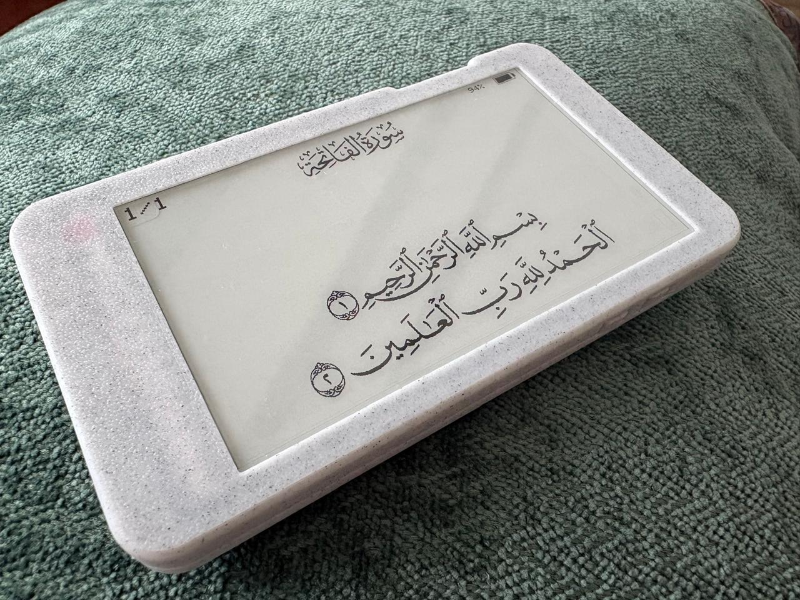
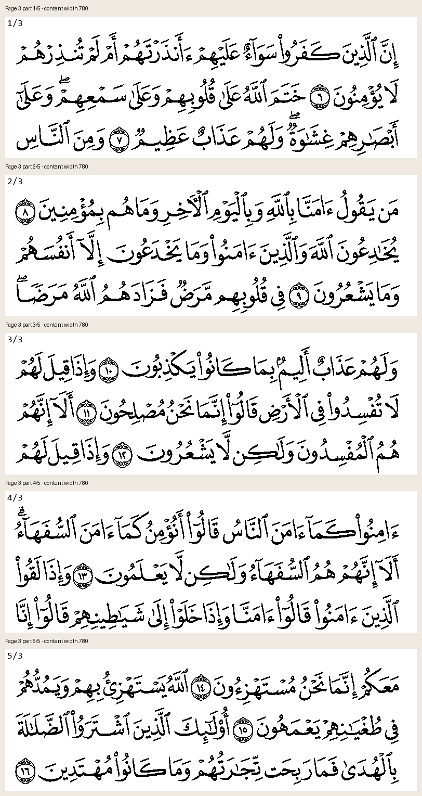

# Quran Handheld — Waveshare and CrowPanel

An offline Quran reader for two ESP32-S3 e-paper boards. Both versions read pre-rendered KFQC/Hafs Mushaf artwork from microSD, with responsive button handling during display refresh. No Wi-Fi or account is needed on the reader.

**[v0.2.0 pre-release downloads](https://github.com/Abduljalilabbasi/quran-handheld/releases/tag/v0.2.0)** · [Installation](docs/INSTALLATION.md) · [Validation](docs/VALIDATION.md) · [Quran source and attribution](ATTRIBUTION.md)

## Choose your board

| | Waveshare ESP32-S3-ePaper-3.97 | Elecrow CrowPanel 5.79-inch |
|---|---|---|
| Display | 800 × 480 B/W | 792 × 272 B/W |
| Reading layouts | Landscape segments and complete portrait pages | Landscape segments |
| Quran collection | 1,810 landscape screens + 604 portrait pages | 604 pages × 5 parts = 3,020 screens |
| Firmware | [Quran_Reader_DualOrientation](firmware/Quran_Reader_DualOrientation) | [CrowPanel_Quran_Full](firmware/CrowPanel_Quran_Full) |
| Setup, pins and controls | [Waveshare guide](docs/WAVESHARE.md) | [CrowPanel guide](docs/CROWPANEL.md) |
| SD folders | `quran`, `quran_portrait` | `quran579` |
| Idle sleep | 3-minute MCU sleep with retained display | No automatic MCU sleep in this version |
| Enclosure | [Original 3MF and browser-viewable STL parts](hardware/enclosure/README.md) | No CrowPanel enclosure supplied yet |

**Firmware and SD images are board-specific. Do not interchange them.**

## Downloads and installation

Download the two files for your board from the [release](https://github.com/Abduljalilabbasi/quran-handheld/releases/tag/v0.2.0):

- **Waveshare:** `Waveshare_Quran_Responsive.zip` and `Waveshare_Quran_SD.zip`.
- **CrowPanel:** `CrowPanel_Quran_Responsive.zip` and `CrowPanel_Quran_SD.zip`.

Extract the SD ZIP and copy its image folders directly to a FAT32 card's root. Open the firmware `.ino` in its matching folder and keep its companion `.h` file beside it. Install the dependencies and upload as described in the board guide. Existing users keep their board's existing image collection; this firmware update does not require reformatting.

The source code, guides, artwork provenance and enclosure models can be browsed directly on GitHub. The thousands of SD binary images are release downloads, keeping Git history manageable. [Rebuild the images](docs/BUILD_ASSETS.md).

## Responsive navigation

Buttons continue to be sampled while e-paper refresh and file reads run. Every valid press updates the requested position. After a 180ms pause, the screen catches up to the latest request, skipping intermediate positions. An already-started physical refresh must finish first.

One press means one landscape segment, or one complete page in Waveshare portrait mode. There is no ten-press limit. Centre hold opens the page selector; clicks cycle fields; hold applies. The power/screen button blanks the screen completely and restores reading. [Control details](docs/CONTROLS.md).

## Waveshare enclosure

Designed by Abduljalil Alabbasi, licensed **CC BY 4.0**. [Printing and assembly guide](hardware/enclosure/README.md) · [Top](hardware/enclosure/top_enclosure.stl) · [Bottom](hardware/enclosure/bottom_enclosure.stl) · [Power button](hardware/enclosure/power_button.stl) · [BOOT button](hardware/enclosure/boot_button.stl)

Also available on [MakerWorld](https://makerworld.com/en/models/3491420-quran-handheld-e-paper-reader-case-esp32-s3-3-97), [Printables](https://www.printables.com/model/1890129-quran-handheld-e-paper-reader-case-esp32-s3-397), and [Thingiverse](https://www.thingiverse.com/thing:7426709). These parts fit the Waveshare project; they are not a CrowPanel case.

## CrowPanel page preview

Digital preview, not a device photograph. The upper-left part/page indicator has reserved white space so it cannot cover artwork.

## Source, licensing and status

Quran artwork originates from the **King Fahd Glorious Quran Printing Complex**, accessed through **[Quran.ws / quran-svg](https://github.com/quran-ws/quran-svg)**, `mushafs/hafs/kfqc/svg`. The artwork is resized and segmented for these displays; no Quran text is generated or retyped. [Attribution and transformation details](ATTRIBUTION.md).

Both responsive firmwares compiled locally. State/button checks and binary-image integrity checks passed. The new responsive handling still needs on-device validation. Automated pixel conservation is not complete linguistic proofreading of segment boundaries. See [validation](docs/VALIDATION.md) for the scope and limitations.

Firmware and tools: **GPL-3.0-or-later**. Waveshare enclosure CAD: **CC BY 4.0**. Quran artwork and third-party dependencies retain their own terms.

These are two maintained hardware variants of this project in one repository. A GitHub fork is unnecessary merely to support another board; forks are useful for independent development of another repository's codebase. Using Quran artwork and software libraries is handled through attribution and their licenses, not by treating the artwork repository as the firmware's upstream.
