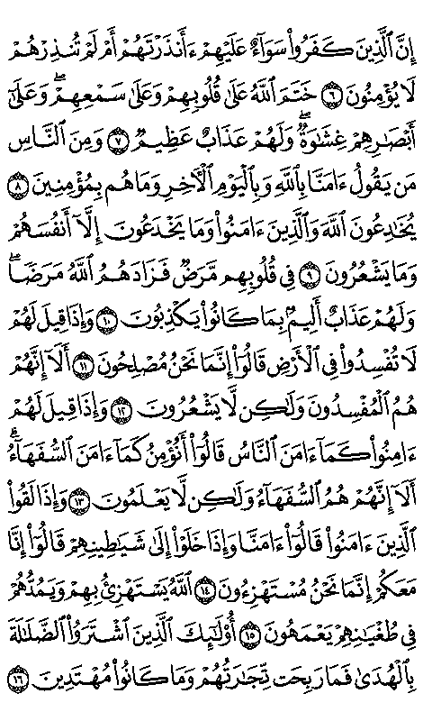

# Quran Handheld — ESP32-S3 e-paper reader

**Draft v0.1.0 · personal prototype**

An offline Quran reader for the Waveshare ESP32-S3-ePaper-3.97. It reads pre-rendered Hafs/Madinah Mushaf images from microSD without Wi-Fi, accounts or a phone.

- Portrait: 604 complete Mushaf pages on a 480 × 800 screen.
- Landscape: larger text in 1,810 sections (two per page for pages 1–2, three thereafter).
- Fast page turns, saved reading position and orientation.
- Side power-button short press: completely blank white screen / restore reading.
- Three-minute ESP32 deep sleep and wake-aware display initialization.
- Three-digit page selector followed by portrait/landscape selection.

[Installation](docs/INSTALLATION.md) · [Controls](docs/CONTROLS.md) · [Hardware](docs/HARDWARE.md) · [Design decisions](docs/DESIGN.md) · [Quran attribution](ATTRIBUTION.md) · [Enclosure](hardware/enclosure/README.md)

## Start here

1. Use the exact Waveshare ESP32-S3-ePaper-3.97 board and a FAT32 microSD.
2. Extract `Quran_SD_Card.zip` from the draft release. Copy both `quran` and `quran_portrait` to the card root.
3. Install the Arduino dependencies and upload `firmware/Quran_Reader_DualOrientation/Quran_Reader_DualOrientation.ino`.
4. Hold the slider centre to select a page/orientation; clicks cycle fields, hold applies.

SD artwork is supplied as a release asset rather than thousands of binary files in Git history. See [rebuilding assets](docs/BUILD_ASSETS.md).

## Full-page preview

This is a digital preview, not a device photograph. Smaller text is the trade-off for showing an entire page on a 3.97-inch panel.

## Source and status

Artwork originates from the **King Fahd Glorious Quran Printing Complex**, accessed through **[Quran.ws / quran-svg](https://github.com/quran-ws/quran-svg)**, `mushafs/hafs/kfqc/svg`. No Quran text is AI-generated. SVG pages are browser-rendered, resized and converted to monochrome. [Attribution](ATTRIBUTION.md) distinguishes publisher artwork from Quran.ws metadata.

The owner reported successful use of the final power-button and fast blank/restore behaviour. The authoring environment could not start its ESP32 compiler because of a Windows DLL relocation error. A CI workflow is supplied but has not yet passed. See [validation](docs/VALIDATION.md).

The owner-supplied enclosure 3MF includes the top, bottom and two button parts. Print settings and assembly guidance are in the [enclosure guide](hardware/enclosure/README.md). Printed fit and CAD redistribution terms still need confirmation.

Firmware and project tools: GPL-3.0-or-later. Artwork, CAD and dependencies retain their own terms. See [LICENSE](LICENSE) and [ATTRIBUTION.md](ATTRIBUTION.md).

